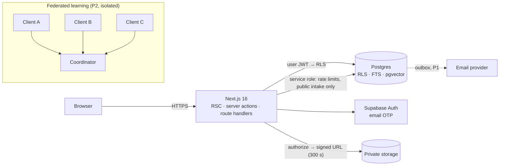
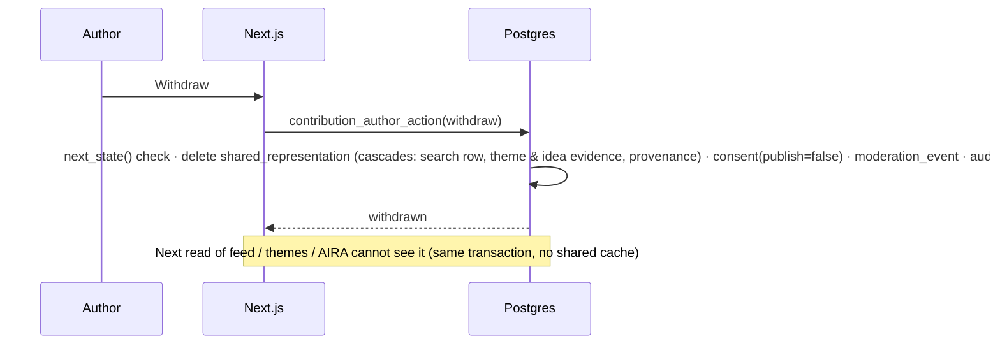

# azentio.ai: website and intelligent collaboration portal

Hackathon build for *Website & Intelligent Collaboration Portal* (Build Requirements v1.0). It includes:
- A public website ported from the reference prototype.
- A secure portal for employees and clients.
- A governed workflow that turns client market observations into de-identified shared learning, themes and improvement ideas.

**All data is synthetic.**

| | |
|---|---|
| Stack | Next.js 16 (App Router) · TypeScript · Tailwind v4 · Supabase (Postgres + RLS, email-OTP auth, pgvector-ready) · Vercel-ready |
| Status | P0 complete. AIRA in retrieval mode (P1). Federated-learning demo in [`fl/`](fl/) (P2) |
| Readiness | [`.readiness-audit/report.md`](.readiness-audit/report.md): **SHIP** for judging, **HOLD** for real production (blockers listed) |
| Governing docs | [constitution](.specify/memory/constitution.md) · [spec](specs/001-portal-p0/spec.md) · [architecture](specs/001-portal-p0/plan.md) · [threat model](THREAT_MODEL.md) · [design system](DESIGN.md) |

## Run it locally (about 5 minutes)

Prerequisites: Node 24+, Docker Desktop.

```bash
npm install
npx supabase start            # Postgres, Auth and Mailpit; applies migrations and synthetic seed
npx supabase status -o env    # copy API_URL / ANON_KEY / SERVICE_ROLE_KEY into .env.local (see below)
npm run build && npm start    # http://localhost:3000
```

`.env.local`:
```
NEXT_PUBLIC_SUPABASE_URL=http://127.0.0.1:54321
NEXT_PUBLIC_SUPABASE_ANON_KEY=<ANON_KEY>
SUPABASE_SERVICE_ROLE_KEY=<SERVICE_ROLE_KEY>
```

**Signing in:** with `DEMO_MODE=on`, `/sign-in` shows a labelled one-click switcher for the 12 synthetic personas (judging only; allow-listed, rate-limited, logged). Otherwise enter a persona email and read the 6-digit code from the local inbox at **http://localhost:54324** (Mailpit). Set `DEMO_MODE=off` (or remove it) for any real deployment.

### Personas (synthetic)
| Email | Role |
|---|---|
| `alex.employee@azentio.com` | Employee |
| `maya.moderator@azentio.com` | Employee + learning moderator |
| `priya.owner@azentio.com` | Employee + product owner |
| `paul.publisher@azentio.com` | Employee + publisher |
| `ada.admin@azentio.com` | Employee + portal administrator |
| `newhire@azentio.com` | Verified domain but **not approved**, so gets no access |
| `ana@northbank.example` | Client member, Northbank |
| `carl.admin@northbank.example` | Client administrator, Northbank |
| `bea@meridian.example` | Client member, Meridian |
| `cora@eastgate.example` | Client member, Eastgate (no SME sandbox entitlement) |
| `dev.consultant@advisory.example` | Member of Northbank **and** Meridian (workspace switcher) |
| `outsider@random.example` | No membership |

## Demo script for judges (the PDF's illustrative scenario)
1. **Moderator** (`maya.moderator@…`) opens **Moderation**. Three seasonal-SME observations are waiting, one flagged as containing a phone number.
2. Publish each one with a coarse region (e.g. *South Asia*) and period, and remove the phone number. Request clarification on one to show the *Returned* path.
3. **Product owner** (`priya.owner@…`): **Themes & ideas → New theme** *"Seasonality context"* with all three items. The theme shows **3 distinct organisations**. With two items it shows *"counts hidden"*.
4. Create an idea for **Financial Analysis Intelligence**, *"seasonality-aware comparison"*, and set it to **Under review** with a public note.
5. **Client** (`bea@meridian…`): **Shared learning** shows the de-identified items, **Themes & ideas** shows the theme and the idea's plain-language status. No private drafts, no reviewer notes, no other client's identity.
6. **Contributor** (`ana@northbank…`): open the published contribution and **Withdraw** it. In Bea's next search it's gone. AIRA no longer cites it either.
7. Boundaries: as Cora, try `/portal/moderation` or `/portal/playground/sme-credit-decisioning` (404). Signed out, try `/api/media/40000000-0000-4000-d000-000000000001` (404).

## Architecture



**Two layers of authorization.**
1. `src/server/authz/policy.ts` decides what to render and which actions to attempt. It's pure and unit-tested.
2. Postgres RLS plus `SECURITY DEFINER` workflow functions (`supabase/migrations/`) enforce the same rules independently. They also own the state machine, the audit log and the outbox in a single transaction.



## Tests
| Command | What it proves |
|---|---|
| `npm test` | `authorize()` persona matrix, validation mirrors DB constraints, synthetic scenarios are deterministic and caveated |
| `npm run test:db` | RLS and workflows against a fresh database: tenant isolation, separate grants, invitations, lifecycle, withdrawal, cohort suppression, reviewer-note secrecy |
| `npm run test:e2e` | Real browser with real email-OTP: illustrative scenario, URL-guessing, AIRA leakage, security headers, accessibility smoke checks |

## Key decisions and honest limitations
- **Identity:** Entra ID was unavailable, so we use Supabase email OTP. An employee needs a verified `@azentio.com` address **and** an approved employee grant.
- **AIRA:** retrieval-only. It cites approved items the caller may see and generates no prose. Claude synthesis can be added later over the same citations.
- **Sensitive-content scan:** heuristic only. It flags content for moderators and is not a privacy guarantee. This is an accepted risk.
- **Attachments:** omitted in P0. Contributors add links instead (allowed by §07).
- **Email:** in-app notifications only. Outbox rows stay `queued`, and nothing is ever labelled "delivered".
- **Federated learning:** a separate, opt-in programme with simulated controls that are labelled as simulated. See [`fl/README.md`](fl/README.md).
